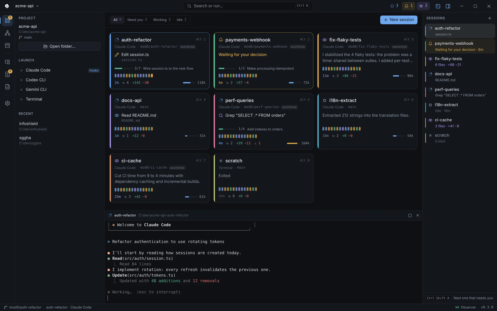

<div align="center">


# MOD0

**Mission control for your AI CLI sessions.**

Run 8–15 Claude Code sessions in parallel without losing the thread: see what each one is doing, which file it touches,
what it's thinking and which one needs you — without reading walls of terminal text.

[Español](README.md) · [Landing](https://moduszero.github.io/landing/en/products/mod0/) · [Project context](docs/CONTEXT.md) · [Current plan](docs/PLAN.md)



</div>

> [!NOTE]
> MOD0 is **no longer a commercial product**. It's the tool I build for my own workflow, published as it is.

## What it is

With AI doing the heavy lifting, the human stops "throwing prompts" and starts **reviewing and orchestrating**. The
bottleneck is following several flows at once. MOD0 **wraps the CLI you already use** and puts a cockpit on top:
Mission Control (one card per session), an always-visible attention panel, a **Thinking Graph**, a **project
dependency graph**, per-session **review** with commit, a **Kanban** that launches sessions in their own git worktrees,
a CodeMirror editor for quick fixes, and native + webhook alerts (WhatsApp, Telegram, ntfy).

It observes **without spending tokens**: Claude Code is launched with `--settings` registering HTTP hooks to a local
server (`127.0.0.1`, random port, per-run token) and its JSONL transcript is read for the "why" of each step. Other CLIs
get state inferred from terminal activity.

## Getting started

Requirements: Node.js 22+, Rust 1.85+, [Tauri prerequisites](https://v2.tauri.app/start/prerequisites/), `git` and your CLI.

```bash
git clone https://github.com/moduszero/mod0.git
cd mod0
npm install
npm run tauri dev
```

BYOK / local AI: define environment variables per CLI profile (Settings → CLI profiles); keep secrets in your system
environment, not in the profile. See [CONTRIBUTING.md](CONTRIBUTING.md) and [docs/CONTEXT.md](docs/CONTEXT.md).

License: [Apache-2.0](LICENSE).
