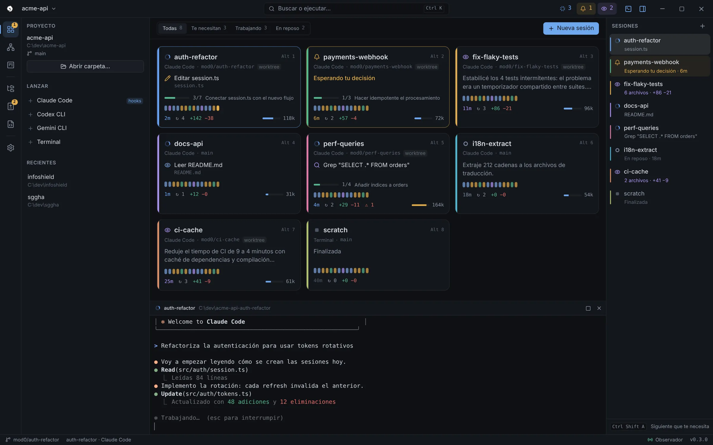
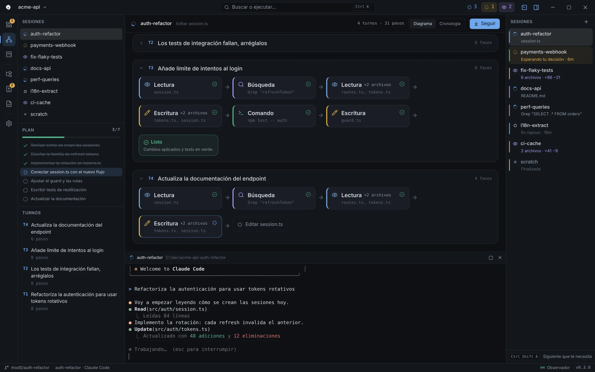
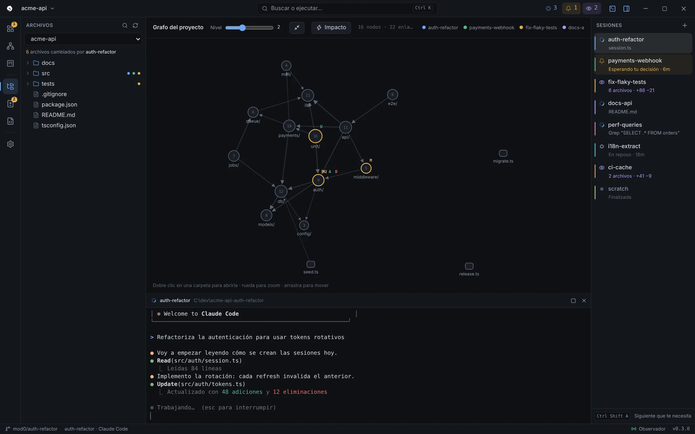
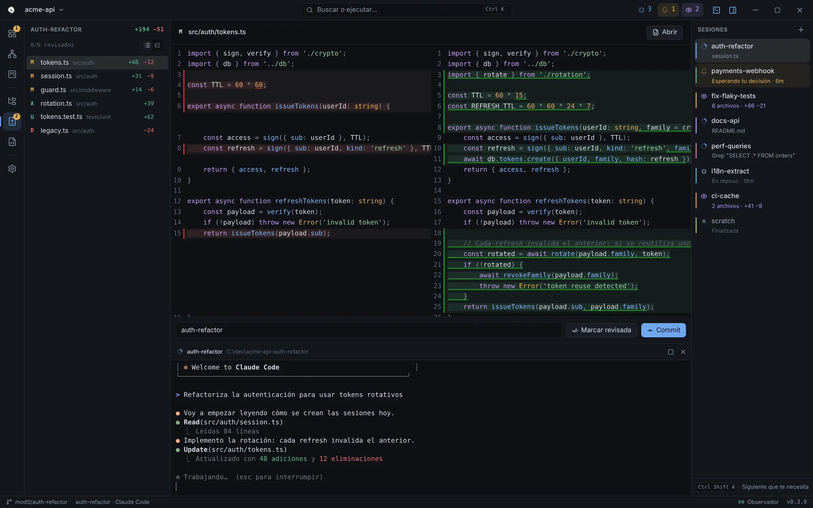
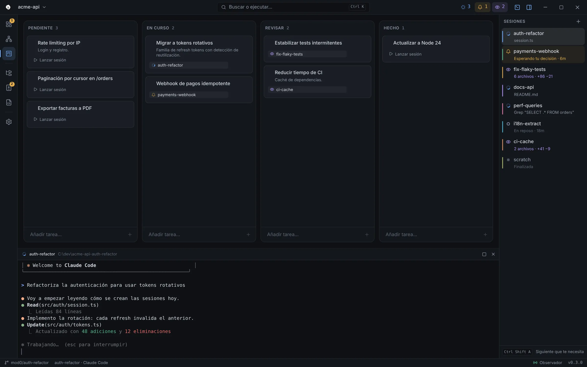

<div align="center">


# MOD0

**Mission control para tus sesiones de CLI con IA.**

Corre 8–15 sesiones de Claude Code en paralelo sin perder el hilo: ve qué hace cada una, en qué archivo trabaja,
qué está pensando y cuál te necesita, sin leer muros de texto de terminal.

[](https://github.com/moduszero/mod0/actions/workflows/ci.yml)


[English](README.en.md) · [Landing](https://moduszero.github.io/landing/es/products/mod0/) · [Documentación](docs/README.md) · [Contexto (IA)](docs/CONTEXT.md) · [Plan actual](docs/PLAN.md)



</div>

> [!NOTE]
> MOD0 **ya no es un producto comercial**. Es la herramienta que construyo para mi propio flujo de trabajo y se publica
> tal cual: con opiniones, abierta y en cambio constante.

## La idea

Con la IA haciendo el trabajo pesado, el humano deja de "tirar prompts" y pasa a **revisar y orquestar**. El cuello de
botella ya no es escribir código: es seguirle el hilo a varios flujos a la vez. Las CLI muestran un registro de texto que
nadie lee de verdad, y los IDE clásicos traen mil funciones que no se tocan.

MOD0 **envuelve la CLI que ya usas** y le pone una cabina encima:

| Pantalla               | Qué resuelve                                                                                                 |
| ---------------------- | ------------------------------------------------------------------------------------------------------------ |
| **Mission Control**    | Una tarjeta por sesión: estado, acción actual, tiempo en estado, contexto usado y cambios.                   |
| **Panel de atención**  | Siempre visible: quién trabaja, quién está bloqueada pidiéndote algo y quién terminó. `Alt+1…9` para saltar. |
| **Thinking Graph**     | El razonamiento de la sesión como grafo (lecturas, ediciones, comandos, ramas paralelas y su porqué).        |
| **Grafo del proyecto** | Carpetas como módulos e imports como flechas, con anillos de color de la sesión que trabaja en cada módulo.  |
| **Revisión**           | Diff por sesión contra el commit con el que empezó, archivos marcados como revisados y commit en un clic.    |
| **Kanban**             | Tareas que lanzan sesiones (con su propio `git worktree`) y se mueven solas según el estado de la sesión.    |
| **Editor**             | CodeMirror 6 para revisar y retocar. No pretende ser tu editor principal.                                    |
| **Avisos**             | Escritorio + webhook (WhatsApp, Telegram, ntfy…) cuando una sesión te necesita o cuando _todo_ terminó.      |

<div align="center">




</div>

## Cómo observa sin gastar tokens

- Cada sesión es una **terminal real (PTY)** que ejecuta tu shell y, dentro, la CLI.
- Para **Claude Code**, MOD0 lanza la CLI con `--settings <archivo>` que registra _hooks HTTP_ hacia un servidor local
  (`127.0.0.1`, puerto aleatorio y token por ejecución). Los hooks se **combinan** con los tuyos, no los reemplazan.
- El _porqué_ de cada paso sale del **transcript JSONL** que Claude Code ya escribe (lectura incremental, solo lectura).
- Con otras CLI (Codex, Gemini, cualquier comando) el estado se **infiere de la actividad de la terminal**; el thinking
  graph y los estados exactos requieren los hooks de Claude Code.

Observar **nunca** cuesta una llamada a un modelo.

## Empezar

Requisitos: [Node.js](https://nodejs.org) 22+, [Rust](https://rustup.rs) 1.85+ y los
[requisitos de Tauri](https://v2.tauri.app/start/prerequisites/) de tu sistema. Además, `git` y la CLI que quieras usar.

```bash
git clone https://github.com/moduszero/mod0.git
cd mod0
npm install
npm run tauri dev        # desarrollo
npm run tauri build      # instalador (en src-tauri/target/release/bundle)
```

### Perfiles de CLI y proveedores

Ajustes → _Perfiles de CLI_ → _Añadir desde una plantilla_. MOD0 no implementa ningún proveedor: envuelve una CLI.

- **Claude Code con otros proveedores** (OpenRouter, Z.ai, Qwen, DeepSeek, tu gateway): mantienes toda la observación.
- **Aider, OpenCode, Qwen Code, Codex, Gemini**: terminal, revisión y estado inferido por actividad.
- **Claves**: escribe `CLAVE=$VARIABLE` y MOD0 la lee del entorno de tu sistema al lanzar la sesión; no se guarda en ningún
  archivo. Cada perfil muestra si la CLI está instalada y si faltan variables.

Detalles en [docs/guide/providers.md](docs/guide/providers.md).

### Avisos al móvil

Ajustes → _Notificaciones_ → _Webhook_ y elige una plantilla (ntfy, Telegram, WhatsApp vía CallMeBot, JSON). Los
marcadores disponibles son `{title}`, `{message}`, `{session}`, `{status}` y sus variantes `_url` y `_json`.

## Atajos

| Atajo                           | Acción                            |
| ------------------------------- | --------------------------------- |
| `Ctrl+K` / `Ctrl+Shift+P`       | Paleta de comandos                |
| `Ctrl+P` / `Ctrl+Shift+O`       | Abrir archivo                     |
| `Ctrl+Shift+N`                  | Nueva sesión                      |
| `Alt+1…9`                       | Saltar a la sesión _n_            |
| `Ctrl+Shift+A`                  | Siguiente sesión que te necesita  |
| `Ctrl+1…6`                      | Cambiar de vista                  |
| `` Ctrl+` ``                    | Mostrar/ocultar la terminal       |
| `Ctrl+Shift+B` / `Ctrl+Shift+R` | Panel lateral / panel de atención |
| `Ctrl +` / `Ctrl -` / `Ctrl 0`  | Zoom de la interfaz               |

Dentro de la terminal solo se interceptan los atajos con `Ctrl+Shift` o `Alt+número`; el resto llega a la CLI.

## Estructura

```text
src/                     Frontend (SvelteKit 3 en modo SPA, Svelte 5 con runes, Tailwind 4)
  lib/core/              types · constants · runes (estado) · services (IPC) · registry · i18n · utils
  lib/components/        common (piezas reutilizables) · layout (marco del IDE)
  lib/features/          terminal · editor · workbench · system-atoms (piezas de cada pantalla)
  lib/systems/           una carpeta por sección/actividad (MainSpace + Sidebar)
src-tauri/src/           Backend (Rust, Tauri 2)
  commands/              puente IPC: una función por comando
  features/              sessions · terminal · observer · workspace · git · notifications · kanban
  core/ · infrastructure/  errores, eventos, estado; almacenamiento atómico y procesos
docs/                    CONTEXT.md (visión y arquitectura) · PLAN.md (tareas y releases)
scripts/                 backend simulado y capturas de pantalla reproducibles
```

## Estado

Versión **0.3.0**. El backend compila, pasa `clippy` y sus pruebas unitarias, y el frontend pasa `svelte-check` y el
build. Lo que **aún no está verificado** en una máquina real (ver [PLAN](docs/PLAN.md)): el arranque completo con Claude
Code real, ConPTY en Windows y los hooks HTTP de tu versión concreta de la CLI. Si algo falla, abre un issue con la
plantilla.

## Contribuir

Lee [CONTRIBUTING.md](CONTRIBUTING.md). Para reportar vulnerabilidades, [SECURITY.md](SECURITY.md).

## Licencia

[Apache-2.0](LICENSE) © Luis Alberto Hernández Roselló
